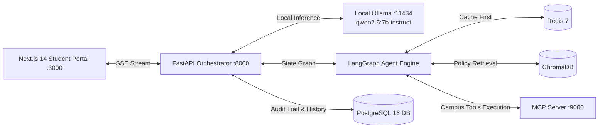

# System Architecture: "Ask, Retrieve, Act" — University Campus AI Agent

## 1. High-Level Overview
The system is an autonomous university campus agentic chat application engineered to dynamically arbitrate between academic policy retrieval, live student/course tool execution, multi-step chained operations, or direct clarification without hallucination.

## 2. Core Agent Graph State Machine
The LangGraph workflow consists of 5 deterministic and LLM-augmented nodes:
- **`Planner`**: Uses local Ollama (`qwen2.5:7b-instruct`) semantic intent reasoning to classify queries into `retrieve_only`, `tool_only`, `retrieve_and_tool`, `answer_directly`, or `insufficient_info` (with automated fallback to the deterministic semantic classifier).
- **`Retriever`**: Queries the university policy vector store with Redis query caching. Enforces a minimum cosine similarity threshold ($\ge 0.65$).
- **`Tool-Executor`**: Connects via HTTP/JSON-RPC to the standalone MCP server for `student_lookup`, `course_lookup`, and `register_course`. Intercepts state-mutating actions (`register_course`) behind a 2-turn confirmation checkpoint.
- **`Responder`**: Uses local Ollama (`qwen2.5:7b-instruct`) to synthesize grounded evidence into student-facing answers with explicit policy document and tool citations.
- **`Clarify`**: Generates targeted follow-up inquiries when retrieval confidence is low or parameters are ambiguous.

## 3. Caching Strategy
- Normalized query strings are hashed with SHA-256 (`rag:cache:<hash>`).
- Cached results store chunk IDs, text snippets, and similarity scores.
- TTL is configured to 10 minutes (600s).
- Tool results are strictly excluded from caching to guarantee live data integrity.

## 4. PostgreSQL Audit Trail
Every single graph run records immutable records in the `AuditLog` table:
- `plan`: Stores planner decision and reasoning.
- `retrieval`: Stores query and retrieved chunks with similarity scores.
- `tool_call`: Stores exact tool name, structured inputs, and structured outputs.
- `clarify`: Stores clarification trigger reason and prompt.
- `final_answer`: Stores sources used and tools invoked.
